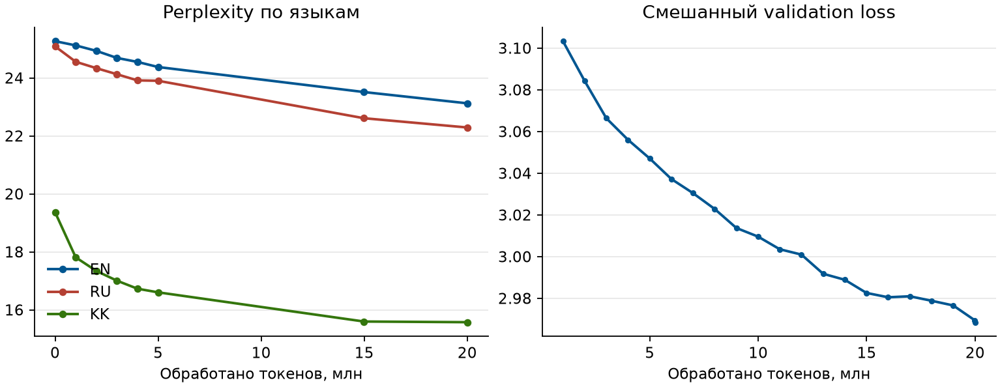

# Этап 13. Корпус v4 и продолжение обучения Tiny

Продолжение [диагностики этапа 12](diagnosis_stage12.md). Цель эксперимента — улучшить языковую подготовку Tiny и отдельно проверить перенос на диалоговые задачи. Число 0,321 из этапа 12 относится к прежней проверке из 53 заданий и служит историческим ориентиром.

## Корпус и разделение выборок

[Каталог источников](../configs/data_v4_sources.json) фиксирует ревизию, SHA-256 файла, категорию и ссылку на условия источника. Сборщики проверяют контрольную сумму при скачивании и при использовании локального кэша. Для статей сохраняются идентификатор и URL, для диалогов — источник, ID записи и родительское дерево или публикация. Результат сборки публикуется локально после успешной обработки.

| Версия | Документы train | Токены train | Различных ID токенов train |
| --- | ---: | ---: | ---: |
| v4, пилот обучения | 21 646 | 21 406 394 | 8 112 |
| v4-expanded, расширенный срез | 23 618 | 21 870 569 | 8 116 |

В пилот вошли Wikipedia EN/RU/KK и Simple English Wikipedia. Расширенный срез включает также художественную литературу, популярную науку, документацию, код и математические объяснения из CPython, а также казахские пользовательские отзывы. Дополнительные источники небольшие, поэтому корпус пока преимущественно энциклопедический. Для разговорной речи использованы проверенные людьми ветки OpenAssistant в SFT. У KazSAnDRA исходные отзывы и задачи по тональности разнесены по ID. Сохранённые токены включают границы документов. Обработанные токены считаются по целям обучения на каждом шаге.

В каталоге указаны [условия Wikipedia](https://huggingface.co/datasets/wikimedia/wikipedia/blob/b04c8d1ceb2f5cd4588862100d08de323dccfbaa/README.md), [условия OpenAssistant](https://huggingface.co/datasets/OpenAssistant/oasst1/blob/fdf72ae0827c1cda404aff25b6603abec9e3399b/README.md), [лицензия CPython](https://docs.python.org/3.12/license.html), [условия Project Gutenberg](https://www.gutenberg.org/policy/permission.html) и [карточка KazSAnDRA](https://huggingface.co/datasets/issai/kazsandra). В художественных текстах отдельно выделяется само произведение. Для кода сохраняются отступы.

Для RU/KK используется классификатор кириллических триграмм, рассчитанный на 1 200 статьях для каждого из RU, KK и KY, с порогом уверенности и проверкой коротких кыргызских выражений. Эти статьи выделены до выборки для обучения. На отдельной проверке из 400 кыргызских статей ни одна не попала в RU или KK. Из 400 русских принято 395 как RU, из 400 казахских — 379 как KK. На английских источниках проверяется согласованность метки и письменности. Это ограничивает обнаружение других языков с латиницей. В 708 валидационных статьях v4 найдено 0 точных совпадений с 278 061 документом v2 после нормализации.

Изоляция использует ID деревьев разговоров, публикаций и нормализованных запросов. MinHash на словных шинглах отсекает близкие текстовые копии. Связанные строки FLORES и Belebele учитывают исходную публикацию. Для v4 SFT проверяются совпадения с корневыми запросами открытого validation. Совпадающие короткие ответы на разные вопросы допускаются. Ответы SQuAD сверяются с их позицией в тексте. Для OpenAssistant используются разметка выполнения задачи и проверенные ветки. Для перевода фильтруются язык, структура и соотношение длины выровненных предложений FLORES. Покрытие свободных парафразов и межъязыковой утечки остаётся неполным. Число повторов контролируется по началу запроса и категории.

В `data/v4/sft_final` лежат раздельные разговорная и семантическая части, SFT-бинарники и манифест. Семантика покрывает чтение, извлечение, классификацию, обобщение, сравнение и причинные вопросы. KazSAnDRA добавляет казахские задания с исходными пользовательскими текстами. Казахская часть пока сконцентрирована на классификации и чтении. Для дальнейшей работы нужны естественные казахские диалоги, парафразы, прагматика, отрицания и разрешение неоднозначности. Математические и кодовые записи ограничены по числу и доле в смеси.

## Протокол оценки

В открытой валидации 540 кейсов, по 180 EN, RU и KK. В неё входят отложенные ветки OpenAssistant, чтение по [Belebele](https://github.com/facebookresearch/belebele), переводы [FLORES-200](https://huggingface.co/datasets/facebook/flores) и казахские инструкции из открытого среза поддержки. При отборе проверялись точные совпадения пользовательских реплик по доступным train-файлам v3.1 и v3.3. Текущий состав перекошен в чтение и перевод. Отдельный локальный закрытый тест из 30 оригинальных кейсов охватывает также повседневное общение, многоходовый контекст, признание незнания и математику. Файл `data/v4/closed_test/test.jsonl` имеет SHA-256 `c9ccdb14614823a47515c715d8cd8b16f47e71ecdb1f63632cbbf65111808207` и резервируется до выбора кандидата на открытых данных.

Внешняя валидация измеряет строгий префиксный Prompt Echo Rate и среднюю повторяемость. Форма ревью хранит естественность, грамотность, связность, семантическую релевантность, выполнение инструкций, точность многоходового ответа, сохранение контекста, галлюцинации, необоснованные отказы, математическую точность и Code Pass@1. У каждого решения есть хеш оцениваемого ответа. Для долей выводятся размер выборки и 95%-й интервал Уилсона. Без разметки доля остаётся неопределённой. Уровень conv-pass > 0,5 на трёх seed относится к исследованию. Для production остаются пороги 90% для простых диалогов, 85% для инструкций, 80% для контекста, менее 5% бессвязных ответов, менее 2% необоснованного копирования запроса и проверка языковой устойчивости.

## Воспроизведение

```bash
.venv/bin/python scripts/build_corpus_v4.py
.venv/bin/python scripts/build_corpus_v4.py --expanded --output data/v4_expanded
.venv/bin/python scripts/build_dialogues_v4.py --output data/v4/sft_final
.venv/bin/python scripts/audit_v4_corpus.py --output experiments/v4/corpus_audit.json
.venv/bin/python scripts/profile_training.py --config configs/tiny_v4_pretrain.yaml \
  --variants foreach fast_causal --steps 5 --repeats 2 --phases \
  --output experiments/v4/pretrain_profile.json
.venv/bin/llm train --config configs/tiny_v4_pretrain.yaml --stop-step 305
.venv/bin/llm resume --config configs/tiny_v4_pretrain.yaml --stop-step 1221
.venv/bin/python scripts/evaluate_v4_language.py CHECKPOINT \
  --output experiments/v4/language.json
.venv/bin/python scripts/evaluate_dialogues_v4.py CHECKPOINT --device cpu \
  --predictions experiments/v4/predictions.jsonl --output experiments/v4/review.json
.venv/bin/python scripts/tokenizer_study_v4.py --output experiments/v4/tokenizer_study.json
.venv/bin/python scripts/profile_scaling_v4.py --steps 4 \
  --output experiments/v4/scaling_profile.json
```

Для SFT-пилота `scripts/train_v4_sft.py` принимает `balanced`, `curriculum` или `replay`. Путь инициализации и отдельный каталог checkpoint обязательны. `--plan-only` показывает план экспозиции и контрольные суммы. Для возобновления используются те же параметры и файлы. Для пересчёта метрик после ревью применяется `--score-only --annotations РАЗМЕТКА.jsonl` с тем же файлом кейсов и checkpoint.

Измерения хранятся в `experiments/v4`. В Git остаются код, декларации источников, конфигурации и краткие результаты.

## Результаты

### Continued pretraining

На Apple M2 Pro с 16 ГиБ ОЗУ запущен Tiny 16 324 992 параметров со своим исходным BPE 8192. Точка старта — Tiny v2, шаг 6000. FP32, длина 512, 16 384 токена на шаг, три равновероятные языковые группы и LR 1e-4 после 15 шагов разогрева. После 4 997 120 токенов эксперимент возобновлён с сохранённым состоянием оптимизатора, генераторов и загрузчика. Второй запуск довёл общий бюджет до 20 004 864 токенов.

| Обработано | PPL EN | PPL RU | PPL KK |
| --- | ---: | ---: | ---: |
| 0 | 25,27 | 25,09 | 19,36 |
| 4 997 120 | 24,37 | 23,90 | 16,60 |
| 14 991 360 | 23,51 | 22,61 | 15,60 |
| 20 004 864 | 23,12 | 22,29 | 15,57 |
| Unigram baseline | 899,98 | 1 114,19 | 907,54 |

В каждой языковой строке использованы те же 65 536 токенов. Замер на 15M выполнен на CPU, остальные на MPS. Смешанный validation loss снизился с 3,1033 на первом миллионе до 3,0471 на 5M и 2,9685 на 20M.



На 304 задачах чтения Belebele выбор цифры 1–4 по логиту первого токена дал 80/304 исходному Tiny v2, 91/304 после 5M и 92/304 после 20M. Это отдельная проверка понимания прочитанного. Она не засчитывается как свободный ответ или conv-pass. Покрытие одного seed и пересечение доверительных интервалов ограничивают вывод о росте семантического качества.

| Бюджет | Время MPS | Статус |
| --- | ---: | --- |
| 5M | 351 с | измерено |
| 20M | 1 404 с суммарно, из них 1 053 с на продолжение | измерено |
| 50M | около 59 мин суммарно или 35 мин после 20M | оценка по фактической скорости |
| 100M | около 117 мин суммарно или 94 мин после 20M | оценка по фактической скорости |

Фактическая скорость двух запусков составила около 14,25 тыс. токенов/с. Для той же формы батча перед следующими бюджетами ожидается примерно 3,1 ГиБ памяти драйвера MPS, максимальный зафиксированный RSS процесса составил 0,65 ГиБ, системный swap находился в пределах 12,87–13,13 ГиБ. MPS использует общую память. Драйверный замер и RSS нельзя интерпретировать как отдельные объёмы физической ОЗУ.

### Профилирование, масштабирование и словарь

На pretraining forward и backward с fast causal занимали 0,364 и 0,753 с на шаг в фазовом замере. End-to-end было около 1,12 с на шаг. Сравнение fast causal и обычной маски на той же форме дало медианы 14 650 и 14 149 токенов/с при двух повторениях. Это небольшой профилировочный срез. В SFT упаковка при 4×512 и накоплении 2 увеличила скорость с 4 736 до 7 364 supervised assistant tokens/s. В фазовом замере packed forward занял 0,090 с, backward — 0,198 с. Для preallocated KV-кэша Tiny 20M на промптах в 32 и 128 токенов первый токен занимал 8,6 и 11,2 мс, последующие — 4,23 и 3,98 мс на токен. Замер inference относится к прямому вызову модели.

| Архитектура, словарь 8 192 | Параметры | MFLOPs/токен, оценка | MPS ГиБ | Токенов/с MPS |
| --- | ---: | ---: | ---: | ---: |
| Tiny | 16 324 992 | 116,8 | 1,07 | 13 316 |
| Small | 52 445 696 | 365,0 | 2,29 | 5 161 |
| Small Plus | 109 339 392 | 731,5 | 4,12 | 2 919 |

Это четырёхшаговый профиль одной формы 2×512 на MPS. Профиль измеряет ресурсы. Вычислительный бюджет в 20M токенов Tiny соответствует примерно 6,40M токенов Small и 3,19M Small Plus при одинаковой формуле FLOPs. В другом эксперименте нужно фиксировать 20M токенов на каждую архитектуру. Прогоны с нуля достаточной длины в этом этапе не проведены. Результаты не доказывают предел Tiny или преимущество Small.

| BPE | UTF-8 байт/токен EN | RU | KK | Python | Параметры Small |
| --- | ---: | ---: | ---: | ---: | ---: |
| 8 192 | 3,10 | 5,07 | 5,20 | 3,07 | 52 445 696 |
| 16 384 | 3,51 | 5,75 | 6,02 | 3,48 | 56 640 000 |
| 32 768 | 3,85 | 6,42 | 6,89 | 3,76 | 65 028 608 |

Проверено 100 документов на язык и отдельный файл Python, с точным восстановлением исходного текста. Скорость кодирования лежала примерно в пределах 3,7–4,8 МиБ/с. Для следующего CUDA-пилота выбран 16 384 как компромисс между сжатием текста и размером связанной матрицы embedding/output. Этот выбор ещё требует проверки качества обученной модели. Действующие checkpoint используют прежний BPE. Конфигурации `{tiny,small,small_plus}_v4_cuda.yaml` рассчитаны на отдельный корпус с 16K BPE и 12 ГБ RTX 4070 SUPER. CUDA здесь недоступна. [Характеристики NVIDIA](https://www.nvidia.com/en-us/geforce/graphics-cards/40-series/rtx-4070-family/).

### SFT и открытая проверка

Четыре прогона от одного Tiny 20M с seed 1234, LR 2e-4 и 327 680 вычислительными позициями каждый. Фактическое число входных токенов отличалось из-за заполнения последовательностей. Curriculum начинает с повышенной доли живых диалогов, затем переходит к общей смеси. Replay задан как 15% вероятности микробатча. В этом запуске 29 из 160 микробатчей оказались replay, и они дали 59 392 из 172 154 целей loss, то есть 34,5%. Это заметно больше номинальной доли микробатчей, поскольку в replay участвуют все токены, а в SFT только маска ассистента. Функция потерь усредняет по фактическим целевым токенам.

| Checkpoint | Входные токены | Assistant tokens | Чтение, из 304 | PPL EN / RU / KK | Conv-pass на 53 старых задачах |
| --- | ---: | ---: | ---: | --- | ---: |
| v31 из этапа 12 | — | — | 69 | — | 0,321 |
| Tiny v4 20M, до SFT | — | — | 92 | 23,12 / 22,29 / 15,57 | 0,075 |
| Balanced | 255 430 | 138 527 | 68 | 32,40 / 31,80 / 22,88 | 0,189 |
| Curriculum | 253 416 | 161 952 | 78 | 31,35 / 31,12 / 22,62 | 0,189 |
| Replay | 267 823 | 112 762 | 75 | 29,14 / 28,12 / 19,17 | 0,094 |
| Dialogue reading, абляция тональности | 243 226 | 176 337 | 75 | 31,74 / 30,50 / 19,98 | 0,189 |

Точность чтения Tiny 20M составила 30,3% на 304 кейсах, 95% ДИ 25,4–35,6%, против 26,3% у исходного pretrain и 22,7% у v31. После SFT точность снова оказалась около случайного выбора из четырёх вариантов. PPL после всех четырёх SFT выросла. Меньшее ухудшение с replay полезно для следующего контрольного эксперимента, но показатели качества не позволяют выбрать победителя.

| Checkpoint | Строгое эхо, из 540 | 95% ДИ | Средняя повторяемость триграмм | Ответ «Жағымды.», из 180 KK |
| --- | ---: | ---: | ---: | ---: |
| v31 | 7 | 0,63–2,65% | 0,073 | 0 |
| Tiny v4 20M | 1 | 0,03–1,04% | 0,254 | 0 |
| Balanced | 0 | 0–0,71% | 0,153 | 116 |
| Curriculum | 0 | 0–0,71% | 0,078 | 150 |
| Replay | 0 | 0–0,71% | 0,163 | 118 |
| Dialogue reading | 1 | 0,03–1,04% | 0,241 | 0 |

Строгое эхо пропускает перефразированный повтор, копирование отдельных частей и ответ на языке исходного текста вместо перевода. Группа тональности оказалась единственной казахской SFT-группой. При её исключении дословный ответ «Жағымды.» исчез на всех 180 казахских кейсах. При этом возвращались многократные повторы содержательных слов, а точность чтения и conv-pass остались низкими.

Выполнен ручной разбор 15 совпадающих кейсов по пяти на язык в рамках этой сессии, без независимого человеческого рецензента. v31, balanced и абляция получили по 0/15 полных ответов, 95% ДИ 0–20,4% для каждой доли. Семантически релевантны 3/15, 1/15 и 2/15 соответственно. На одном проверенном многоходовом кейсе и одном кодовом кейсе все три ошиблись. Этого среза недостаточно для оценки математической точности или надёжного Code Pass@1. Автоматические метрики рассчитаны на всех 540 с зафиксированным SHA-256 набора.

Фрагменты реальных ответов:

- На вопрос FUP v31 начал с «Әділ пайдалану саясаты — адамның өзгеруі», balanced вернул «Жағымды.», а абляция начала с «Сондай-ақ, ол туралы FUP.» и повторяла фрагмент об уведомлении.
- На вопрос о разнице между HTML и JavaScript v31 ответил «The difference between HTML is the number of ways to write.» Абляция начала с «The first code is that the first code is a list of languages» и перешла к повторам.
- В кейсе чтения о перекрытии въездов абляция ответила «They were used as a detour for the funds of the FBI.» В тексте было указано, что въезды заблокировали.

### Решение

Бюджеты 50M и 100M оценены, но серия остановлена после 20M. Чтение практически перестало улучшаться между 5M и 20M, а свободная генерация после SFT остаётся хуже исторического ориентира. При равновероятном выборе языков 50M дали бы около шести проходов по казахскому срезу пилотного корпуса. До следующего длительного запуска нужен новый срез нативных разговоров и чтения, особенно KK, с проверенной независимой разметкой. Первый следующий эксперимент уже проведён: абляция группы тональности. Для полноценного curriculum нужны отдельные проверенные выборки для восьми стадий, включая использование инструментов. Temperature sampling, KL и более длинное сравнение архитектур оставлены как отдельные эксперименты с парным контролем.

Ни один checkpoint не прошёл исследовательский порог. Трёхseedовая проверка и production-оценка остаются открытыми. Закрытый тест зарезервирован. Смена обслуживаемой модели и проверка её маршрутов в Studio выполняются после появления кандидата. DPO и Developer Agent остались вне серии.

### Проверки кода

Ruff и Mypy прошли. Полный Pytest дал 390 passed и 14 skipped. Среди пропусков — сценарии CUDA и Docker. Black для изменённых Python-файлов проходит, полный Black выделяет прежнее форматирование в `tests/test_accounts.py`. Regression-срез покрывает загрузку checkpoint, воспроизводимость split, качество и маски данных, оценку, обучение, inference и production gates.
