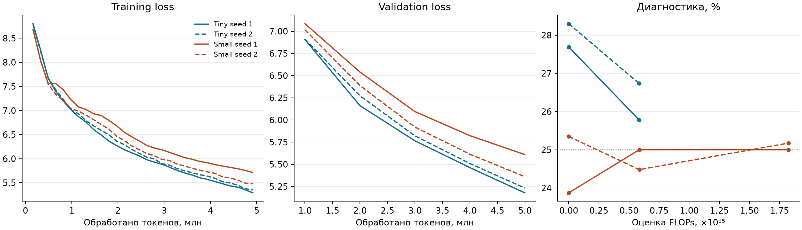

# Этап 17. Ёмкость модели, данные и бюджет обучения

Продолжение [этапа 16](stage16_core_training.md). [Пререгистрация](stage17_preregistration.md) зафиксирована коммитом 0af4651 до первого шага обучения. Этот этап сравнивает холодный старт Tiny и Small. Checkpoint, уже прошедшие pretraining, используются как исторические ориентиры и калибровка диагностики.

## Граф зависимостей и исходное состояние

Graphify MCP был построен на 33527c8. От него до начального HEAD 72db7c68 изменились файлы Studio и её документации. Локальный Graphify обновлён на 72db7c68 в AST-режиме без LLM. На входе 488 представленных файлов, 5 425 узлов, 15 099 рёбер, 238 сообществ. Десять файлов неподдерживаемых форматов не попали в граф. Для HTML использован сводный вид сообществ. Стоимость извлечения — 0 входных и выходных токенов.

Граф подтвердил прямой вызов CheckpointManager из build_trainer. В runner сходятся словарь BPETokenizer, PackedTokenLoader и CausalLM. Trainer использует CausalLMObjective и AdamW, а CheckpointManager сохраняет веса, RNG, состояние загрузчика и оптимизатора. Evaluation Engine читает checkpoint через load_model_for_inference, проверяет версию токенизатора и использует тот же CausalLM. Model Registry в Studio читает manifest через training.promotion. Содержимое бинарных данных и статистическая независимость выборок проверены отдельно, поскольку они не видны в AST.

Инвентаризация нашла 252 исторических каталога с метаданными и файлом весов. В реестре experimental указывает на Tiny v31 step 120, production имеет значение null. Для v31 baseline conv-pass 17/53. Основной токенизатор имеет 8 192 ID и версию c9931e24cbcc4963. У Tiny v2 step 6000 в метаданных 196 608 000 обработанных токенов данного прогона, у continued pretraining v4 — ещё 20 004 864, у SFT v31 — 810 843 токена его этапа. Эти числа измеряют экспозицию, а не количество разных обучающих текстов или слов. Исходный production manifest SHA-256 6e666a7a4495b6197795cae52398b7b8d41f5f2470ad0512e938ddbc12fda4bc, веса v31 SHA-256 5231aee87675be857093f811d85aa94ef6585e121122c855cb8d6f960df67d7d.

## Проверка диагностики

v1 содержит 150 заданий и 13 повторов нормализованного префикса. Повторы включают задания «выберите верное утверждение» с разными вариантами. Одинаковая длина всех четырёх вариантов по BPE встречалась в 8/150 строках. У правильного ответа токенизированная длина была единственной минимальной в 23/150, единственной максимальной в 22/150.

v2 содержит 1 152 задания в 96 семействах. В каждой из 36 ячеек «язык × задача» по 32 строки, каждый правильный индекс встречается 8 раз. Совпадающих нормализованных префиксов нет. Во всех строках четыре разных последовательности токенов. Длины вариантов совпадают в 813/1 152 строках. Совместная токенизация префикса и варианта совпала с конкатенацией их ID для 4 608/4 608 вариантов v2 и 600/600 v1. Сохранены оценки среднего условного log-prob, суммы log-prob, варианта без префикса, unigram, случайного выбора, минимальной длины и второго числового ранга. Сравнение моделей использует парное ресемплирование семей и отдельно показывает разброс двух seed. Интервал Уилсона в сырых отчётах описывает долю по строкам и не учитывает семейную зависимость.

Набор преимущественно процедурный. В заданиях знаний проверяются атомные номера, в блоках грамматики, отрицания и чтения используются близкие конструкции. Номинальные 1 152 строки не эквивалентны 1 152 независимым жизненным ситуациям. Нижние границы интервалов для узких категорий следует интерпретировать с учётом общего источника. Для свободной генерации дополнительно использовались независимые задачи v4, результаты которых приведены отдельно.

## Аудит общего обучающего корпуса

| Показатель | Значение |
| --- | ---: |
| Документов train / validation / test | 23 618 / 708 / 442 |
| JSONL train, байт | 98 491 727 |
| Сохранённых train-токенов | 21 870 569 |
| Различных BPE ID train | 8 116 |
| Токены EN / RU / KK | 8 403 211 / 10 496 867 / 2 970 491 |
| Точные дубликаты train после нормализации | 0 |
| Точные совпадения целых документов train ↔ validation / test | 0 / 0 |
| Документы train с U+FFFD, NUL или серией характерных маркеров mojibake | 0 |

Проверены SHA-256 всех 11 источников по каталогу и манифесту. Один источник используется только как языковой референс. Энциклопедия и Simple English составляют 21 646 документов, или 91,7%. Нативные казахские отзывы дают 1 643 документа, английское художественное произведение 219 фрагментов, популярная наука 83, техническая документация и математические объяснения по 13, программный код один файл. Несмотря на 47% казахских документов, на них приходится около 14% токенов. Отдельного слоя общих практических знаний, диалогов и проверенных объяснений причин или сравнений нет. Сами категории и примеры в выборке не измеряют семантическое покрытие всех статей.

Источники train включают Wikipedia EN/RU/KK/Simple English (CC BY-SA 3.0), KazSAnDRA (CC BY 4.0), *Pride and Prejudice* и *The Chemical History of a Candle* (public domain), а также туториал CPython, `functools` и `statistics` (PSF 2.0). Кыргызская Wikipedia отмечена как языковой референс, её вклад в выбранный train равен нулю. Полные ревизии, происхождение и лицензионные поля заданы в [каталоге источников](../configs/data_v4_sources.json).

Сканирование трёх 24-словных якорей на документ нашло совпадения в train для 2/708 validation и 4/442 test-документов. В 1 056 диагностических префиксах длиной от восьми слов совпадений с train не найдено. Это лексическая проверка. Она пропускает свободные парафразы, совпадающие короткие реплики и совпадения вне взятых якорей. Ранние validation loss рассчитаны по зафиксированным бинарникам с этим ограничением.

В выборке из 24 документов, по восемь на язык с отбором по устойчивому хешу, встретились пустые скобки после удаления разметки, межъязыковая ссылка в тексте, канцелярские и словарные обрывки, опечатки. Есть связные литературные реплики и естественный казахский запрос в отзыве. Это наблюдения одного просмотра. Ручная оценка качества всех документов не проводилась. Три проверенных факта подтвердились: Мока — административный центр Эспайльята, у департамента Тарн код 81 и центр Альби, режиссёр «Короля комедии» — Мартин Скорсезе. [Закон Доминиканской Республики](https://presidencia.gob.do/sites/default/files/laws/2023-07/Ley%2041-23.pdf) · [INSEE](https://www.insee.fr/fr/metadonnees/geographie/departement/81-tarn) · [AFI](https://catalog.afi.com/Film/67056-THE-KINGOFCOMEDY).

| Язык | Пустые скобки | Межъязыковые строки | Маркер причины | Маркер сравнения |
| --- | ---: | ---: | ---: | ---: |
| EN, 8 274 документа | 764 | 5 | 1 472 | 359 |
| RU, 4 265 документов | 1 964 | 0 | 881 | 561 |
| KK, 11 079 документов | 658 | 137 | 562 | 311 |

Разметка удалена неполно, особенно в RU. Маркеры причины и сравнения являются лексическими признаками. Они не служат проверкой правильности рассуждений. Формат и тематический отбор стоит менять отдельным вмешательством и измерять при том же числе токенов.

## Ресурсы и методика

| Профиль | Параметры | MFLOPs/токен | Токенов/с при загрузочном профиле | Память драйвера MPS, ГиБ | Системный swap, ГиБ |
| --- | ---: | ---: | ---: | ---: | ---: |
| Tiny | 16 324 992 | 116,8 | 14 393 | 3,14 | 13,10 |
| Small | 52 445 696 | 365,0 | 5 475 | 6,23 | 13,67 |
| Small Plus | 109 339 392 | 731,5 | 3 053 | 8,33 | 15,04 |

Калибровка MPS FP32 выполнена при 8×512 на случайном входе. Она не входит в оценку качества. Mac располагает 16 ГиБ общей памяти, в начале снимка свободно 90 ГиБ диска. При переходе Tiny → Small первый процесс остановился на проверке доступной RAM, измерив 4,23 ГиБ против требуемых 6,98. Повтор после выхода предыдущего процесса начался с того же замороженного плана. Отдельные последовательные процессы освободили буферы MPS между архитектурами. Сохранённый дедлайн серии не переносился.

Каждая архитектура внутри seed использует один и тот же packed stream. На шаге 305 использовано по 4 997 120 target tokens. При приблизительно равных FLOPs Tiny 305 сравнивается со Small 98, или 1 605 632 target tokens. Это соотношение 5,838×10¹⁴ и 5,861×10¹⁴ FLOPs по фиксированной формуле. Целевые точки 20M, 50M и 100M заданы как будущие остановки той же траектории. Учитывая корпус 21,87M, эти режимы потребуют повторных проходов с 50M.

## Калибровка измерителя

| Baseline | Mean log-prob, из 1 152 | Sum log-prob | Только варианты без промпта |
| --- | ---: | ---: | ---: |
| Равномерный случайный выбор, зафиксированный seed | 25,35% | — | — |
| Unigram из train | 24,39% | — | — |
| Самый короткий вариант | 26,22% | — | — |
| Второй числовой ранг, вне чисел случайно | 24,91% | — | — |
| Tiny, случайная инициализация seed 1 / 2 | 27,69 / 28,30% | 25,26 / 28,12% | 28,12 / 26,30% |
| Small, случайная инициализация seed 1 / 2 | 23,87 / 25,35% | 23,96 / 25,09% | 23,35 / 27,43% |
| Tiny v2 | 42,10% | 43,58% | 23,70% |
| Tiny v4 continued pretraining | 40,45% | 42,53% | 24,48% |
| Tiny v31 SFT | 44,62% | 48,70% | 25,52% |

Превышение 25% у случайного Tiny показывает остаточную чувствительность измерителя к форме вариантов. У v31 89/96 по узкой семантической конструкции и 10/96 по контексту. Эти срезы измеряют разные навыки. Общая точность не снимает необходимость смотреть на ключи, счёт без промпта и свободные ответы.

## Отдельное сравнение BPE

Новые BPE обучены на одном наборе документов из train. Для замера использованы по 100 документов RU/EN/KK из test, плюс отдельный CPython graphlib.py. Все пробные тексты восстановлены без потерь. Степень сжатия — длина исходного UTF-8 в байтах, делённая на объём массива uint16 токенов.

| Словарь | Символов/токен EN / RU / KK / Python | Сжатие EN / RU / KK / Python | Кодирование EN / RU / KK / Python, МиБ/с | Embedding Small FP32 |
| --- | --- | --- | --- | ---: |
| 8 192 | 2,97 / 2,83 / 2,75 / 3,07 | 1,49 / 2,54 / 2,52 / 1,54 | 3,30 / 3,30 / 3,77 / 3,16 | 16 МиБ |
| 16 384 | 3,31 / 3,19 / 3,18 / 3,48 | 1,66 / 2,87 / 2,91 / 1,74 | 2,60 / 4,00 / 4,56 / 3,73 | 32 МиБ |

RSS процесса после обучения словарей составил 397 и 481 МиБ соответственно, при последовательном выполнении в одном процессе. Этот замер включает память окружения и аллокатора. В Small при 16K становится 56 640 000 параметров против 52 445 696 при 8K, а тензор logits на один токен удваивается. Улучшилось сжатие всех четырёх срезов. Качество отдельных архитектур с новым словарём не сравнивалось. Основная серия использует 8 192 BPE c9931e24cbcc4963.

## Результаты обучения на 5M

Среднее ± выборочное стандартное отклонение двух seed. Точности приведены в процентах. Conv-pass измерен на историческом наборе из 53 кейсов, чтобы сохранить сопоставимость с этапом 16. MPS peak — максимум счётчика памяти драйвера, замеренный при обучении. Train loss — последний зарегистрированный пакет.

| Модель | Обработано токенов на seed | Параметры | FLOPs, ×10¹⁵ | Validation loss | Train loss | Диагностика | Знания | Семантика | Контекст | Инструкции | Conv-pass | Токенов/с MPS | Пик MPS, ГиБ | Минут на seed |
| --- | ---: | ---: | ---: | ---: | ---: | ---: | ---: | ---: | ---: | ---: | ---: | ---: | ---: | ---: |
| Tiny | 4 997 120 | 16 324 992 | 0,584 | 5,206 ± 0,038 | 5,347 ± 0,052 | 26,26 ± 0,68 | 19,79 ± 1,47 | 39,06 ± 0,74 | 26,04 ± 8,84 | 17,19 ± 3,68 | 1,89 ± 0,00 | 13 964 ± 72 | 3,14 ± 0,00 | 5,96 ± 0,03 |
| Small | 4 997 120 | 52 445 696 | 1,824 | 5,486 ± 0,176 | 5,603 ± 0,246 | 25,09 ± 0,12 | 18,23 ± 2,21 | 33,85 ± 6,63 | 23,44 ± 0,74 | 19,79 ± 1,47 | 1,89 ± 0,00 | 5 093 ± 312 | 6,27 ± 0,00 | 16,38 ± 1,00 |

Суммарное время обучения по четырём прогонам составило 44,7 минуты. Компенсация микробатча из-за OOM не понадобилась. Максимальный замер системного swap составил 14,04 ГиБ для Tiny и 14,12 ГиБ для Small. Пиковый наблюдавшийся RSS процесса 0,70 и 0,30 ГиБ соответственно, отдельно от счётчика MPS. Экспериментальные checkpoint, включая контрольные и состояния оптимизатора, занимают 5,8 ГиБ.

В пределах seed совпали SHA-256 фактически пройденного порядка последовательностей обеих моделей. Каждый полный прогон прочитал 9 760 окон длины 512 из первого прохода, с 8 079 разными BPE ID у seed 1 и 8 084 у seed 2. Точки Small с сопоставимыми FLOPs прошли по 3 136 окон, с 8 025 и 8 008 разными ID. Контрольные состояния содержат параметры оптимизатора, RNG и позицию загрузчика.

| Модель и бюджет | PPL EN seed 1 / 2 | PPL RU seed 1 / 2 | PPL KK seed 1 / 2 |
| --- | ---: | ---: | ---: |
| Unigram | 893,92 | 1 041,69 | 956,04 |
| Small 1,606M | 771,34 / 630,39 | 850,47 / 704,12 | 1 360,20 / 1 153,83 |
| Tiny 5M | 182,85 / 187,71 | 149,72 / 164,98 | 221,19 / 227,20 |
| Small 5M | 256,52 / 211,97 | 252,09 / 197,88 | 341,76 / 246,76 |

PPL рассчитана на зафиксированных 32 768 целевых токенах каждого языка. Падение train и validation loss при росте объёма не сопровождалось таким же изменением общего диагностического результата.



## Парные сравнения и гипотезы

| Сравнение | Метрика | Заданий | Разница seed 1 / 2, п.п. | Средняя разница, п.п. | Относительная разница | Семейный 95% ДИ, п.п. |
| --- | --- | ---: | ---: | ---: | ---: | ---: |
| Small − Tiny, равные токены | Диагностика | 1 152 | −0,78 / −1,56 | −1,17 | −4,46% | [−3,39; +1,13] |
| Small − Tiny, равные токены | Знания | 96 | −4,17 / +1,04 | −1,56 | −7,89% | [−8,85; +5,21] |
| Small − Tiny, равные токены | Семантика | 96 | −10,42 / 0,00 | −5,21 | −13,33% | [−10,94; +1,04] |
| Small − Tiny, равные FLOPs | Диагностика | 1 152 | −0,78 / −2,26 | −1,52 | −5,79% | [−4,38; +1,26] |
| Small − Tiny, равные FLOPs | Без грамматики | 1 056 | +1,23 / −1,23 | 0,00 | 0,00% | [−3,08; +2,89] |
| Tiny 5M − инициализация | Знания и семантика | 192 | +1,04 / +3,65 | +2,34 | +8,65% | [−8,07; +13,28] |
| Small 5M − инициализация | Знания и семантика | 192 | −0,52 / +4,17 | +1,82 | +7,53% | [−5,99; +9,64] |
| Small 5M − Small 1,606M | Знания и семантика | 192 | −2,08 / +7,81 | +2,86 | +12,36% | [−2,86; +8,59] |

H1–H4 не достигли заранее заданных порогов. Для H3 направление первичного результата по знаниям разошлось на двух seed. В первичной метрике равных FLOPs стандартное отклонение двух парных разниц составило 1,04 п.п. При сумме log-prob эффект по равным FLOPs меняет знак на +0,61 п.п. с 95% ДИ [−2,39; +3,47]. При исключении грамматики средняя разница сводится к нулю. H6 не подтверждена.

Против unigram на 5M парная разница Tiny +1,87 п.п. с 95% ДИ [−1,87; +5,64], Small +0,69 п.п. с 95% ДИ [−2,73; +4,08]. Использование полного промпта у Small при равных FLOPs дало −1,82 п.п. относительно оценки только вариантов с 95% ДИ [−3,99; +0,30]. Общая точность пока не подтверждает практическое использование контекста.

В отдельных поисковых сравнениях интервал семантики Small − Tiny при равных FLOPs составил [−27,60; −5,21] п.п. Средний эффект −15,62 п.п. У самого Small между 1,606M и 5M семантика меняется на +10,42 п.п. и знания на −4,69 п.п., с интервалами [+0,52; +21,35] и [−9,38; −0,52]. Эти интервалы не включают ноль в данном наборе. Они вторичные, без поправки на множественные проверки и при двух seed, поэтому статистически подтверждённого эффекта по пререгистрированным критериям нет.

H5 не запускалась. Условие перехода к SFT, 20M, 50M, 100M и третьему seed не выполнено. Положительное заключение о Small и заявление о пределе Tiny на этом горизонте не поддерживаются.

## Свободная генерация

У всех четырёх моделей на 5M — 0/54 по проверяемым ответам естественного набора v4. 95% интервал Уилсона для каждого прогона 0–6,64%. Исторический Tiny v31 на этом наборе — 4/54. На всех 126 запросах незавершённых ответов Tiny 98/112 на seed 1/2, у Small 103/83, у исторического v31 — 6. Средняя доля повторов у Tiny 0,358/0,364, у Small 0,212/0,214. Автоматическая разметка незавершённости и повторов не оценивает релевантность. Просмотр ответов выявил энциклопедические списки и фрагменты, не связанные с вопросом.

| Запрос | Tiny, seed 1, начало ответа | Small, seed 1, начало ответа |
| --- | --- | --- |
| What is 38 plus 47? | ` (03)\n\nSeama (192)\nBarali (177)\n\nReferences` | `, the first sestication of the United States.` |
| Сколько лет моей собаке? | ` сюжетом, в том числе, что и не не не не не` | `.\n\nВ том время в Кее, вернере в составе в Моку` |
| Қыста түн неге ұзағырақ? | `, шақу, тырын, бөзін, алу, әңгі, тарту, т.б.б.б.` | `.\n\nДереккөздер\n\nДереккөздер` |

Показаны дословные префиксы с переносами, записанными как `\n`. Полные локальные ответы и provenance лежат в `experiments/stage17/*.chat.jsonl`. Была просмотрена выборка примеров. Полной слепой ручной оценки естественности и проверки production gates не было.

## Следующий эксперимент

По этим данным есть свидетельства тематического перекоса и дефектов очистки, но измеренный эффект их исправления отсутствует. Малый горизонт и близость к случайной диагностике не позволяют найти предел Tiny. 16K улучшает сжатие, особенно для KK, но повышает стоимость слоя вывода. Эти замеры не показывают влияние словаря на способности модели.

Максимум информации на единицу compute даст парный A/B на Tiny с теми же двумя seed, 8K и фиксированной экспозицией. Фиксация до старта должна включать устранение совпадений validation/test в обеих группах, контроль из исходной выборки, отдельную сбалансированную группу из проверенных лицензированных источников и новую проверку обобщения за пределами атомных номеров. Первичную метрику следует измерять на знаниях и семантике, вторичные — PPL по языкам и свободные ответы. При положительном результате повторить вмешательство на Small. Small Plus в этой серии только профилировался. Контролируемый SFT остаётся условным, DPO не запускался.

## Профилирование Small

Короткий профиль на MPS, macOS 26.6.2 и PyTorch 2.15.0. У всех вариантов 16 384 токена на шаг. Для исходного FP32 8×4 пошаговый таймер показал 1,01 с forward, 1,96 с backward и 0,034 с AdamW. Накопление сохраняет тот же объём на шаг. Синхронизированный счётчик не включает время сохранения checkpoint, которое отдельно составило 1,26 с. В pretraining упакованные окна заполнены полностью, поэтому полезные токены и позиции совпадают. Supervised throughput измеряется на соответствующем SFT, здесь такого прогона не было.

| Вариант | Токенов/с | Память драйвера MPS, ГиБ | Макс. разница loss с FP32 8×4 |
| --- | ---: | ---: | ---: |
| FP32 SDPA, 8×4 | 5 271 | 6,27 | — |
| FP32 SDPA, 4×8 | 5 487 | 3,21 | 0 |
| BF16 SDPA, 8×4 | 4 139 | 5,30 | 0,000198 |
| FP32 с activation checkpointing, 8×4 | 4 291 | 2,21 | 0 |
| FP32 с нативным GQA SDPA, 8×4 | 5 408 | 6,21 | 0,000001 |

У FP32 4×8 память драйвера в коротком замере снизилась на 49%. Прирост скорости 4% измерен в одном повторе и не служит подтверждением ускорения. Checkpointing уменьшает использование памяти, но в этой конфигурации требует дополнительного backward. BF16 и GQA не переносились в основной эксперимент. Математические операции модели остались прежними.

На Small seed 2 при 24 новых токенах предварительно выделенный KV cache дал 162–164 токена/с против 155–157 у `concat`. На входах 32 и 128 токенов первое продолжение появилось через 10,48 и 12,89 мс при предварительном выделении, через 10,30 и 12,95 мс при конкатенации. Пиковый замер MPS около 1,05 ГиБ. Cache выделяет 8 МиБ, из которых в конце использовано 0,86 и 2,36 МиБ. Измерялся прямой inference, три повтора, без серверного транспорта.

## Воспроизведение

Команды запускаются из корня проекта с подготовленным корпусом v4-expanded, замороженным словарём c9931e24cbcc4963 и существующим окружением `.venv`. Содержимое этапа сохраняется в игнорируемые каталоги. Повтор команды `train_stage17.py` до дедлайна продолжит из последнего проверенного checkpoint. После дедлайна автоматическое продление закрыто.

```sh
.venv/bin/python scripts/prepare_stage17.py
.venv/bin/python scripts/audit_stage17_corpus.py
.venv/bin/python scripts/profile_scaling_v4.py --micro-batch 8 --output experiments/stage17/profile_mb8.json

for job in tiny-seed-1 small-seed-1 tiny-seed-2 small-seed-2; do
    .venv/bin/python scripts/train_stage17.py --job "$job" || break
done

for seed in 1 2; do
    .venv/bin/python scripts/evaluate_stage17.py \
        "tiny-init-$seed=random:tiny:$seed" \
        "small-init-$seed=random:small:$seed" \
        "tiny-5m-$seed=checkpoints/stage17/tiny-seed-$seed/step-00000305" \
        "small-equivalent-$seed=checkpoints/stage17/small-seed-$seed/step-00000098" \
        "small-5m-$seed=checkpoints/stage17/small-seed-$seed/step-00000305"
done

.venv/bin/python scripts/summarize_stage17.py
.venv/bin/python scripts/plot_stage17.py --output docs/figures/stage17_capacity.png
```

Для графика нужен Matplotlib. Поязыковую оценку, свободную генерацию и исторический conv-pass воспроизводят соответственно `evaluate_v4_language.py --tokens data/v4_expanded/tokens --batches 64`, `evaluate_dialogues_v4.py --cases configs/natural_eval_v4.jsonl --batch-size 8 --max-new-tokens 64` и `compare_conversations.py --data-dir data/v4_expanded` на тех же checkpoint. Все оценки качества этой серии выполнялись на CPU.

## Проверки кода

`ruff check src tests scripts` и `mypy src` завершились успешно. Полный `pytest -rA` дал 482 passed и 14 skipped, отдельная регрессия обучения, checkpoint и inference — 66 passed. В пропусках полного прогона тесты Docker без настроенного образа, недоступная CUDA и существующая проверка BF16 autocast. Black принял все 14 изменённых Python-файлов. Полный Black указал на шесть существующих файлов вне изменений этапа. SHA-256 рабочего v31 и production manifest повторно сверены, production равен null.
